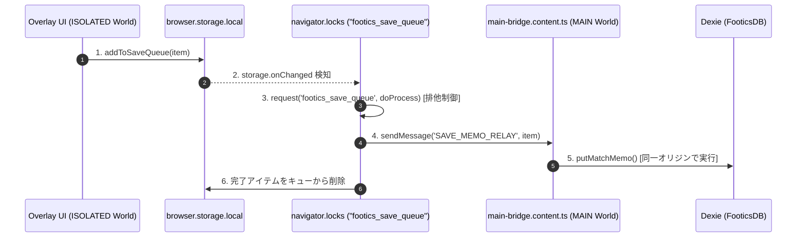

# クロスプラットフォーム・コンポーネント設計スキルガイド

Footics Web アプリ（戦術分析ボード、Next.js）と Chrome Extension（動画オーバーレイ・クイックキャンバス、WXT）で、**同一の UI コンポーネントやドメイン機能を安全に共有し、初期チラつき（Flicker）や黒マージン等の副作用を排除し、6大設計品質原則を満たすための実践スキル**です。

---

## 1. ディレクトリと配置のゴールデンルール

コンポーネントおよび機能モジュールは、必ず以下の 4 階層に対応するディレクトリ構造に配置します。

```
src/features/<feature-name>/  (または extension/features/<feature-name>/)
├── components/          # Level 2: Domain UI Blocks (Web/Ext 100% 共用・Context経由で状態購読)
├── core/                # Level 1〜2: ヘッドレス描画コア、プラグイン定義
│   ├── tools/           # ツール・アノテーションプラグイン (OCP 準拠)
│   └── store/           # Store Provider (Vanilla Store Factory + React Context)
├── hooks/               # ヘッドレスなビジネスロジック・幾何計算 (純粋関数・カスタムフック)
├── services/            # Level 3: 複数ステップのパイプライン・低レベル操作ファサード (SLAP 担保)
├── types/               # ドメイン型・プラグインインターフェース・メッセージプロトコル
└── views/               # Level 3: Feature Views (Provider で囲む初期化・合成層)
```

- **ホスト境界の原則**: `chrome.*` API、`window.location.search`、Dexie DB への直接アクセスは、必ず **Level 4 (Shell)** または **Level 3 (Feature View)** に隔離し、`components/` 配下に持ち込んではなりません。

---

## 2. 6大設計品質原則の実践パターン・カタログ

### Pattern 1: 完全な Store Provider パターン (結合度・SRP 担保)

単一のグローバル Zustand ストア（シングルトン）は、Extension や別タブ、モーダルでの状態衝突や初期チラつき（Flicker）を引き起こします。
また、**Provider 配下でグローバルシングルトンを直接参照するアンチパターン（二重結合）を厳禁**とし、以下のように Context Hook 経由で統一します。

```tsx
// 1. ストアファクトリ関数の定義 (Vanilla Store)
import { createStore } from 'zustand/vanilla';
import { createContext, useContext, useRef } from 'react';
import { useStore } from 'zustand';

export interface FeatureConfig {
  initialData?: string;
  mode?: 'view' | 'edit';
}

export function createFeatureStore(config: FeatureConfig) {
  return createStore<FeatureState>((set, get) => ({
    mode: config.mode ?? 'view',
    data: config.initialData ?? '',
    setData: (data) => set({ data }),
  }));
}

// 2. React Context と Provider の定義
type FeatureStoreApi = ReturnType<typeof createFeatureStore>;
const FeatureStoreContext = createContext<FeatureStoreApi | null>(null);

export function FeatureStoreProvider({
  config,
  children,
}: {
  config: FeatureConfig;
  children: React.ReactNode;
}) {
  const storeRef = useRef<FeatureStoreApi | null>(null);
  if (!storeRef.current) {
    // マウント時の初期値として Props を確定注入（Flicker ゼロ保証）
    storeRef.current = createFeatureStore(config);
  }
  return (
    <FeatureStoreContext.Provider value={storeRef.current}>
      {children}
    </FeatureStoreContext.Provider>
  );
}

// 3. ドメイン内部用カスタム購読フック（シングルトン直接参照を禁止し、ここ経由で取得）
export function useFeatureStoreContext<T>(selector: (state: FeatureState) => T): T {
  const store = useContext(FeatureStoreContext);
  if (!store) {
    throw new Error('useFeatureStoreContext must be used within FeatureStoreProvider');
  }
  return useStore(store, selector);
}
```

> [!CAUTION]
> **禁止パターン (手動同期 useEffect)**:
> マウント後に `useEffect` 内で `useGlobalStore.getState().reset()` や `setField(...)` を呼んでシングルトンを手動同期するコードを禁止します。必ず `Provider` の `initialState` に確定注入してください。

---

### Pattern 2: Extension Command / Message Registry パターン (OCP 担保)

`background.ts` や IPC ルーターで `if (command === '...')` や `switch` 分岐をベタ書きすることを禁止し、自己完結したハンドラーをレジストリに登録する形式にします。

```typescript
// 1. コマンドハンドラーインターフェースの定義
export interface ExtensionCommandHandler {
  readonly command: string;
  execute(tab?: chrome.tabs.Tab): Promise<void>;
}

// 2. レジストリクラスの定義
export class CommandRegistry {
  private handlers = new Map<string, ExtensionCommandHandler>();

  register(handler: ExtensionCommandHandler): this {
    this.handlers.set(handler.command, handler);
    return this;
  }

  async dispatch(command: string, tab?: chrome.tabs.Tab): Promise<boolean> {
    const handler = this.handlers.get(command);
    if (!handler) {
      console.warn(`[CommandRegistry] Unhandled command: ${command}`);
      return false;
    }
    await handler.execute(tab);
    return true;
  }
}

// 3. 各ハンドラーの実装（単一責務・独立テスト可能）
export class CaptureCommandHandler implements ExtensionCommandHandler {
  readonly command = 'capture-to-tactical';
  constructor(private readonly captureService: CaptureService) {}

  async execute(tab?: chrome.tabs.Tab): Promise<void> {
    if (!tab?.id) return;
    await this.captureService.triggerCapture(tab.id);
  }
}

// 4. background.ts での配線（コアコードの改変ゼロで新コマンド追加可能）
const registry = new CommandRegistry()
  .register(new CaptureCommandHandler(captureService))
  .register(new ToggleMiniModeHandler())
  .register(new MemoOverlayCommandHandler());

browser.commands.onCommand.addListener((command, tab) => {
  void registry.dispatch(command, tab);
});
```

---

### Pattern 3: Service Facade & Pure Shell パターン (SLAP 担保)

Level 4 Application Shell（Content Script や HTML main）は、UI マウントとイベントリスナー配線のみの「純粋マウンター」に徹し、低レベルな複数ステップの処理は `Service Facade` にカプセル化します。

```typescript
// features/capture/services/capture-facade.ts (低レベル詳細を隠蔽)
export class CaptureFacade {
  static async captureCurrentVideo(): Promise<CaptureResult> {
    const video = findVideoElement();
    const cleanup = video ? prepareDRMHardenedUI(video).cleanup : () => {};
    try {
      if (video) await waitForNextFrames(3);
      const rawCapture = await requestTabCapture();
      const croppedDataUrl = await cropActiveVideoArea(rawCapture, video);
      return await processAndOpenCanvasPipeline(croppedDataUrl);
    } finally {
      cleanup(); // RAII による確実な原状回復 (Locality)
    }
  }
}

// entrypoints/overlay.content.tsx (Level 4 Shell: 1行で高レベル意図を表現)
onMessage('TRIGGER_CAPTURE', async () => {
  const result = await CaptureFacade.captureCurrentVideo();
  if (result.success) {
    useOverlayStore.getState().setToast('🎨 Quick Canvasを開きました');
  }
});
```

---

### Pattern 4: Single-Protocol Host Bridge パターン (直交性・局所性 担保)

Extension Content Script と Web 本体の境界通信において、`postMessage` と `CustomEvent` を同時に発行する二重発火を禁止し、型安全な単一プロトコルで通信します。

```typescript
// 1. 型安全なプロトコル定義 (src/lib/types/capture-protocol.ts)
export interface BridgeMessage<T = unknown> {
  source: 'footics-extension';
  type: string;
  payload: T;
}

export function isBridgeMessage<T>(event: MessageEvent, type: string): event is MessageEvent<BridgeMessage<T>> {
  return event.data?.source === 'footics-extension' && event.data?.type === type;
}

// 2. 送信側 (extension/features/storage-sync/footics-app-bridge.ts)
export function notifyAppCapture(payload: TacticalCapturePayload): void {
  const message: BridgeMessage<TacticalCapturePayload> = {
    source: 'footics-extension',
    type: 'TACTICAL_CAPTURE',
    payload,
  };
  window.postMessage(message, window.location.origin);
  // CustomEvent の併用は禁止（二重発火の根絶）
}

// 3. 受信側 (src/hooks/use-data-sync.ts)
useEffect(() => {
  const handleMessage = (e: MessageEvent) => {
    if (isBridgeMessage<TacticalCapturePayload>(e, 'TACTICAL_CAPTURE')) {
      queryClient.invalidateQueries({ queryKey: matchKeys.detail(e.data.payload.matchId) });
    }
  };
  window.addEventListener('message', handleMessage);
  return () => window.removeEventListener('message', handleMessage);
}, [queryClient]);
```

---

### Pattern 5: Cross-Origin Storage Sync パターン (マルチタブ排他制御)

拡張機能オリジン（`chrome-extension://`）から Web アプリオリジン（`https://footics.app`）の IndexedDB への書き込みは、マルチタブ競合を防ぐため Web Locks API と Storage Queue を組み合わせます。



---

### Pattern 6: WXT Entrypoint DI & Testability パターン (テスタビリティ担保)

エントリポイント内の処理をモジュール外からテスト可能にするため、Chrome API 依存を関数引数やサービスクラスとして切り離します。

```typescript
// 1. 純粋関数/サービスクラスとしてロジックを export (testable)
export async function findFooticsTab(
  tabsApi: Pick<typeof chrome.tabs, 'query'> = chrome.tabs,
  appUrls: string[] = FOOTICS_APP_URLS,
): Promise<chrome.tabs.Tab | undefined> {
  const tabs = await tabsApi.query({});
  return tabs.find((t) => appUrls.some((url) => t.url?.includes(url)));
}

// 2. background.ts では配線のみ
export default defineBackground(() => {
  browser.action.onClicked.addListener(async () => {
    const tab = await findFooticsTab(browser.tabs);
    // ...
  });
});

// 3. 単体テスト (background.test.ts)
test('findFooticsTab finds matching tab among open tabs', async () => {
  const mockTabs = [
    { id: 1, url: 'https://youtube.com' },
    { id: 2, url: 'https://footics.app/match/123' },
  ] as chrome.tabs.Tab[];

  const result = await findFooticsTab({ query: vi.fn().mockResolvedValue(mockTabs) });
  expect(result?.id).toBe(2);
});
```

---

## 3. Imperative Ref API 契約 (グローバルイベントの全廃)

親（TopBar 等）から子（Canvas 等）へのアクション実行（エクスポート、画像コピー、Undo/Redo 等）に、`window.dispatchEvent(new CustomEvent(...))` を使ってはなりません。
`forwardRef` と `useImperativeHandle` による明示的な契約を定義してください。

```tsx
// 1. Ref インターフェースの定義
export interface CanvasCoreHandle {
  exportPng: (opts?: ExportOptions) => Promise<string>;
  copyToClipboard: (opts?: ExportOptions) => Promise<void>;
  undo: () => void;
  redo: () => void;
}

// 2. コンポーネント側での実装
export const CanvasStageContainer = React.forwardRef<CanvasCoreHandle, CanvasStageProps>(
  (props, ref) => {
    const stageRef = useRef<Konva.Stage>(null);
    const { undo, redo } = useCanvasActions();

    useImperativeHandle(ref, () => ({
      exportPng: async (opts) => {
        const stage = stageRef.current;
        if (!stage) throw new Error('Stage not ready');
        return stage.toDataURL({ pixelRatio: opts?.pixelRatio ?? 2 });
      },
      copyToClipboard: async (opts) => {
        // クリップボードコピー処理
      },
      undo,
      redo,
    }));

    return <Stage ref={stageRef} ... />;
  }
);
```

---

## 4. 汎用プラグイン / レジストリ設計 (OCP の徹底)

ツール、アノテーションオブジェクト、ダッシュボードウィジェット、エクスポート形式など、将来バリエーションが増える機能は、すべてプラグイン型で設計します。

1. **プラグインインターフェースの定義**:
   - `id`, `label`, `icon`, `createObject`, `PreviewComponent`, `RenderComponent`, `OptionsComponent`
2. **コア側のレシーバー**:
   - コアコンポーネント（Stage, Toolbar, Inspector等）は、プラグイン配列を受け取って動的にループまたは描画するだけにし、`if-else` による分岐を持たないこと。
3. **自己申告型オプション**:
   - オブジェクトの属性変更 UI は、プラグイン自身が `OptionsComponent` として提供し、Web の Inspector でも Extension の HUD でも同じコンポーネントをスロット自動展開すること。
