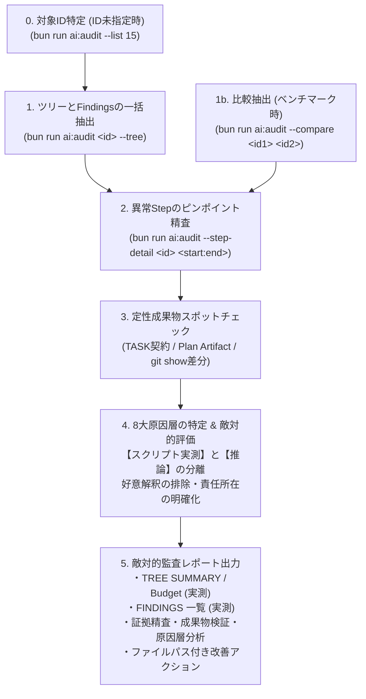

# 敵対的セッション・エージェント行動監査スキル (Adversarial Session Audit Protocol)

本スキルは、別コンテキストや過去セッションで走行したエージェント（Planner / Worker / Architect）の実行ログと成果物を、**最小トークンで調査・診断し、2階層パイプラインのボトルネック・規約違反・品質バイパス・ガード誤爆を冷徹・敵対的に糾弾・改善する** ための標準プロトコルです。

---

## 1. 監査の全体フロー (End-to-End Workflow)



---

## 2. 構造化ログ抽出コマンド (Core Audit Commands)

生の `transcript.jsonl` を安易に `cat` や `read_file` で開いてはならない（トークンが急膨張し、物理ガードでも遮断される）。必ず専用スクリプトを使用すること。

### A. セッション一覧 / ツリー・全検出器の自動実行（基本初手）
親セッションおよび全サブエージェントを再帰走査し、サマリーと全自動検出器の Findings を 1 手で出力する。
```bash
bun run ai:audit --list 15
bun run ai:audit <session_id> --tree
bun run ai:audit <session_id> --tree --from-request "<keyword>" --compact
bun run ai:report <session_id>
```
* **出力項目**:
  * TREE SUMMARY: Sessions (ロール別内訳), Total Turns, Duration, Total Tokens (In+Cache/Out), Hook Denials, Bypasses, Inefficiencies, Findings 件数
  * FINDINGS: INFRA / EXP / READ / PIPE / EFF / QUAL 検出器による HIGH / MED / LOW / INFO 判定と Step 番号

### B. ステップピンポイント精査 (Zero-Token Evidence Inspector)
疑わしい Step の ToolCall, Arguments, Status, Token消費, Error/Output をピンポイント抽出する。
```bash
bun run ai:audit --step-detail <session_id> <start:end>
```

### C. ステップ範囲の概要確認
指定ステップ範囲のツール呼出サマリー（1行要約）を確認する。
```bash
bun run ai:audit --steps <session_id> --range 50:80
```

### D. 2セッションの横並び比較 (Benchmark Comparison)
改善前（Before）と改善後（After）の効果を客観的に比較する。
```bash
bun run ai:audit --compare <before_id> <after_id>
```

---

## 3. 33 検出器体系 (Audit Detectors)

スクリプト（`ai:audit`）は以下の 33 項目（`INFRA` 3 / `EXP` 10 / `READ` 10 / `PIPE` 5 / `EFF` 3 / `QUAL` 2）を自動判定する：

| カテゴリ | ID | コード | 重大度 | 検知内容 |
| :--- | :--- | :--- | :--- | :--- |
| **INFRA** | INFRA-01 | `TOOL_MISSING` | HIGH/MED | 必須ツール（Worker の `run_command`/`edit_file`/`write_file` 等）未呼出・欠落訴え |
| | INFRA-02 | `HOOK_ROLE_MISMATCH` | HIGH | ガードがエージェントのロールまたは Worker ID を誤認して誤爆 |
| | INFRA-03 | `UNEXPANDED_TEMPLATE` | LOW | `${var}` 等の未展開テンプレート文字列がガード文言に残存 |
| **EXP** | EXP-01 | `OUTLINE_BYPASS` | HIGH | Planner が `ai:outline` / `rg` / `ai:find` 未使用のまま 3 件以上の対象ソースを直読 |
| | EXP-02 | `BAD_FIRST_MOVE` | MED | `repo_summary.txt` / `tasks/TASK-*.md` / `ai:outline` 等を経由せずソースコードを初手読込 |
| | EXP-03 | `EXPLORE_SHARE` | MED | 最初の編集/サブエージェント起動までの探索ターン率が 30% 超過 |
| | EXP-04 | `SERIAL_INDEPENDENT` | LOW | 独立した単一ファイル `read_file` の 3 連続以上直列実行（並列化違反） |
| | EXP-05 | `LINECOUNT_PUZZLE` | MED | スライス遮断前後での `wc -l` / `nl` 行数確認パズル |
| | EXP-06 | `GUESSED_PATH` | LOW | 存在未確認パスへの当て推量アクセス（File not found 遮断） |
| | EXP-07 | `SCOPE_VIOLATION` | HIGH | 引数なし/ディレクトリ指定の `ai:check` や Worker での生 `vitest`/`bun test` 等実行 |
| | EXP-08 | `REPEAT_DENIAL` | HIGH | 同一ファイル/コマンドへの連続ガード遮断 |
| | EXP-09 | `ROLE_VIOLATION` | HIGH | Planner / Worker / Architect / Auditor の編集・コマンド越権 |
| | EXP-10 | `BLIND_REDO` | MED | 直近コマンドの引数を変えない無意味な連続再実行 |
| **READ** | READ-01 | `SMALL_SLICED` | MED | 400 行以下小型ファイルの `StartLine`/`EndLine` スライス読込 |
| | READ-02 | `SEQ_SLICING` | HIGH | 同一ファイルへの連続スライス読込（ページ送り）または遮断 |
| | READ-03 | `LARGE_FULL_BLIND` | MED | 400 行超大型ファイルの事前 `ai:outline` / `rg` / `grep` なし全文読込 |
| | READ-04 | `DUPLICATE_READ` | LOW | 間に編集を挟まない同一ファイルの重複読込 |
| | READ-05 | `EDIT_WITHOUT_RAW_READ` | HIGH | `read_file` 未実行ファイルへの `edit_file` / `write_file(Overwrite: true)` |
| | READ-06 | `RTK_READ_BASIS` | HIGH | 要約出力（`rtk read`）のみを根拠にしたコード編集 |
| | READ-07 | `RAW_LOG_READ` | HIGH | `transcript*.jsonl` / `.system_generated/logs` への直接アクセス |
| | READ-08 | `HEAVY_READ_TOP` | INFO | 読込容量上位 5 ファイルのサマリー提示 |
| | READ-09 | `READ_UNUSED` | LOW | 読込後に本文・次ステップ `tool_calls` のいずれにも参照されないファイル |
| | READ-10 | `WORKER_EXPLORES` | MED | `TASK_ASSIGN` および割り当て Phase の `Target Files` 外ファイルへの Worker 読込 |
| **PIPE** | PIPE-01 | `WORKER_REUSE_OR_NO_KILL` | HIGH/MED | 完了済/肥大化 Worker の再利用試行、または `TASK_COMPLETE` 後の `manage_subagents(kill)` 漏れ |
| | PIPE-02 | `POLLING_LOOP` | MED | `manage_subagents(list)` の連続ポーリング |
| | PIPE-03 | `INTEGRATION_GATE_BYPASS` | HIGH | `TASK_COMPLETE` 後の `ai:preflight`/`ai:commit` 未実行、または生 `git commit` 試行 |
| | PIPE-04 | `TASK_VALIDATE_BYPASS` | MED | `tasks/TASK-*.md` 作成・編集後の `task:validate` 未実行、またはタスクサイズ/塊超過遮断 |
| | PIPE-05 | `ABOLISHED_SUBAGENT_ATTEMPT` | HIGH | 廃止済 `scout`/`reviewer` 起動または `define_subagent` 試行 |
| **EFF** | EFF-01 | `CONTEXT_BLOAT_ALERT` | HIGH/MED | Worker 25/35 ターン超過、または 1 ターン `In+Cache` > 180K/300K 到達 |
| | EFF-02 | `SERIAL_WORKER_DISPATCH` | LOW | 並列起動可能にもかかわらず 3 回以上単発直列で Worker を起動 |
| | EFF-03 | `PROMPT_BLOAT` | LOW | `invoke_subagent` Prompt が 1500 文字超過（ポインタ渡し違反） |
| **QUAL** | QUAL-01 | `QUALITY_OR_MOCK_BYPASS` | HIGH | `src/`/`extension/`/`tests/` への `biome-ignore`・`test.skip`・`@ts-expect-error`・Store `vi.mock`・`--no-verify` |
| | QUAL-02 | `ARCH_PATTERN_VIOLATION` | MED | セレクタなしストア購読・`CustomEvent`・旧 Adapter/シングルトンストアの新規記述 |

---

## 4. 8大原因層の特定 (The 8 Root Cause Layers)

監査官は、検出された Finding・Bypass・定性問題の根本原因を以下の 8 層から客観的に特定する：

1. **Planner**: タスク分解不備、`ai:outline`/`rg` 不使用、並列 Phase 化漏れ、完了 Worker の `kill` 漏れ、`ai:commit`/`ai:preflight` 漏れ
2. **Worker**: TDD 手順違反、ガード遮断後の反省なし再実行、生コマンド連打、スライス読込、Lint/テスト/モック逃避
3. **Architect**: `.agents/**`・`docs/**` スコープ外アクセス試行、非許可コマンド試行
4. **Task設計 (`tasks/TASK-*.md`)**: 局所契約違反、二重持ち/フォールバック設計、ストアモック指示、肥大化
5. **Hook (ガード)**: 親/子ロール誤認による誤爆、不親切なエラーメッセージによる迷走誘発
6. **Rule (.agents/rules/)**: 規約の曖昧さ、矛盾、旧世代用語の残存
7. **Agent 定義 (.agents/agents/)**: ツール権限欠落、モデル・プロンプト不備
8. **Script (.agents/scripts/)**: `ai:*` スクリプトのバグ、終了コード・出力形式の不整合

---

## 5. 敵対的監査レポートテンプレート (Adversarial Audit Report Template)

調査結果は以下のフォーマットで冷徹・論理的に出力する：

```markdown
# 敵対的セッション監査レポート: <session_id>
（※旧3階層時代のログを含む場合: 「[注記] 旧3階層ログを含むため現行2階層規約との世代差を差し引いて評価」を記載）

## 1. エグゼクティブサマリー (Executive Summary)
- 【スクリプト実測】Sessions: X (Roles), Total Turns: XX, Duration: XXs, Total Tokens: In+Cache=XXK / Out=XX, Hook Denials: X件, Bypasses: X件
- 【推論】パイプライン全体の総合評価（冷徹判定：合格 / 要改善 / 致命的欠陥）。完了結果に惑わされず、工程・トークン効率・コード品質の欠陥を総括。

## 2. 定量実績・トークン予算比較 (Quantitative Tree Summary & Budget)
【スクリプト実測】（手集計せず `ai:audit --tree` の `TREE SUMMARY` をそのまま転記）
| 項目 (Metric) | 実測値 | 基準 / 所見 |
| :--- | :--- | :--- |
| **Sessions / Roles** | X 体 (...) | Subagent 過不足・kill 状態 |
| **Total Turns** | XX ターン | Worker 推奨 <= 25 / 上限 35 |
| **Duration** | XX 秒 (Think: XXs, Tool: XXs) | — |
| **Total Tokens** | In+Cache=XXK (In: XXK, Cache: XXK) / Out=XX | Peak > 180K 要警戒 |
| **Hook Denials / Bypasses / Ineff** | Denials: X件 / Bypasses: X件 / Ineff: X件 | — |
| **Findings 内訳** | HIGH=X, MED=X, LOW=X, INFO=X | — |

## 3. 自動検出結果 (Automated Findings)
【スクリプト実測】（`ai:audit --tree` の FINDINGS リストを転記）
- [HIGH] `EXP-01` OUTLINE_BYPASS: Step 12 (...)
- [HIGH] `PIPE-03` INTEGRATION_GATE_BYPASS: Step 48 (...)
- [HIGH] `QUAL-01` QUALITY_OR_MOCK_BYPASS: Step 31 (...)

## 4. 証拠精査・定性成果物検証・原因層分析 (Evidence, Artifacts & Root Cause)
- 【スクリプト実測】異常 Step 詳細: `--step-detail <session_id> <start:end>` の出力要約
- 【定性スポットチェック】`tasks/TASK-*.md` / Plan Artifact / `git show <hash>` の検査結果（二重持ち・Store モック・フォールバック・規約違反の有無）
- 【推論】原因層分析:
  - **問題事象**: 何が起きたか
  - **原因層**: Planner / Worker / Architect / Task設計 / Hook / Rule / Agent定義 / Script
  - **なぜ起きたか**: 好意解釈を排し、指示・ガード・スクリプト・規約のどこに穴があったか論理的に指摘

## 5. 再発防止と改善アクション (Actionable Remediation)
【推論】再発を物理的・構造的に防止するためのファイルパス付き改善提案：
1. `path/to/rule.md`: ○○の禁止を明文化
2. `path/to/guard.ts`: ○○のパターンを物理遮断するガードを追加
3. `path/to/agent.md`: プロンプトの指示を△△に改修
```
