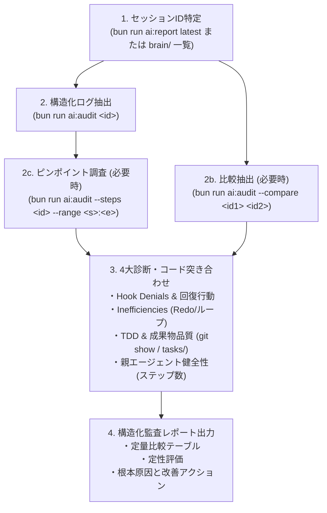

# セッション・エージェント行動監査スキル (Session Audit Protocol)

本スキルは、別コンテキストや過去セッションで走行したエージェント（Planner / Worker / Reviewer / Scout）の実行ログを、**メインチャットのコンテキストを汚さず最小トークンで調査・比較・診断する** ための標準プロトコルです。

---

## 1. 監査の全体フロー (End-to-End Workflow)



---

## 2. 探索・特定手順 (Session Identification)

生の `transcript.jsonl` を安易に `cat` や `view_file` で開いてはならない（トークンが急膨張するため）。必ず専用スクリプトを使用すること。

### ① 直近セッションまたは ID の特定
```bash
# 直近セッションの概要確認
bun run ai:report latest

# 過去のセッションディレクトリを更新順に確認
rtk run "ls -lt ~/.gemini/antigravity-cli/brain/ | head -n 10"
```

### ② 親セッションとサブエージェントツリーの特定
親セッション ID を `ai:audit` に渡すと、起動されたサブエージェント ID 一覧（Spawned Subagents）が末尾に出力される。
```bash
bun run ai:audit <parent_session_id>
```

---

## 3. 構造化ログ抽出コマンド (Core Audit Commands)

### A. 単一セッションの詳細診断
```bash
bun run ai:audit <session_id>
```
* **出力項目**:
  * Turns (ターン数), Duration (所要時間: Think vs Tool), Tokens (In / Cache / Out)
  * Hook Denials (どのガードに何回拒否され、直後に何を実行したか)
  * Inefficiencies (コマンド連打、Blind Redo)
  * Bypasses (biome-ignore や test.skip による品質骨抜き)
  * Subagent Contract Violations (ルール欠落の動的エージェント作成)

### B. 2セッションの横並び比較 (Benchmark Comparison)
改善前（Before）と改善後（After）の効果を客観的に比較する。
```bash
bun run ai:audit --compare <before_id> <after_id>
```
* Turns, Duration, Tokens, Denials, Redo の差分比率（%）が Markdown テーブルで一発出力される。

### C. ステップピンポイント調査 (Zero-Token Step Inspector)
巨大なログを直接読まず、指定ステップ範囲のツール呼出とエラー有無のみを 1 行要約で取得する。
```bash
bun run ai:audit --steps <session_id> --range 800:830
```

---

## 4. 4大監査着眼点 (The 4 Audit Lenses)

### ① Hook Denials とその後の回復行動
* **確認点**: ガードフック（`guard.ts`, `gateguard`, `token-filter` 等）で遮断されたステップがあるか。
* **評価**:
  * 遮断後に自律的に正しい代替コマンド（`rtk grep` や `view_file` 一括読込）へ切り替えられたか。
  * フックの誤爆（親エージェントに対する Worker 制限の適用など）が発生していないか。

### ② Inefficiencies（不毛なループ・生コマンド連打）
* **確認点**:
  * `wc -l` 計測連打（行数パズル迷走）がないか。
  * 生の `vitest`, `tsc`, `biome check` を個別に連打していないか（`bun run ai:check` に集約されているか）。
  * 同一コマンドの無意味な再実行（Blind Redo）がないか。

### ③ TDD & 成果物品質（コード・タスク突き合わせ）
* **確認点**:
  * テスト先行（RED確認）を行ってから実装したか。
  * `git show <commit_hash> --stat` で余計な設定変更やホスト依存が混入していないか。
  * タスクファイル（`tasks/TASK-*.md`）の受入要件チェックボックスが実態と一致しているか。

### ④ 親エージェント健全性（ライフサイクル管理）
* **確認点**:
  * 親エージェント（Planner）の累積ステップ数が 800 を超えて肥大化していないか。
  * 各 Phase 完了後にサブエージェントが直ちに破棄（`kill`）されているか（ゾンビ化防止）。

---

## 5. 報告テンプレート (Audit Report Template)

調査結果は以下のフォーマットで簡潔・論理的に提示する：

```markdown
## 1. 総合評価 (Executive Summary)
- 結論と改善効果の要約（定量的・定性的）

## 2. 定量比較ベンチマーク (Quantitative Benchmark)
| 指標 (Metric) | Before (Phase X) | After (Phase Y) | 改善率 / 差分 |
| :--- | :--- | :--- | :--- |
| **Turns (ターン数)** | XX ターン | YY ターン | -ZZ% |
| **Duration (所要時間)** | XX 秒 | YY 秒 | -ZZ% |
| **Tokens (Total In+Cache)** | XX K | YY K | -ZZ% |
| **Hook Denials** | X 件 | Y 件 | — |
| **Redo / ループ連打** | X 回 | 0 回 (根絶) | — |

## 3. 定性監査所見 (Qualitative Audit Findings)
- 要件網羅性・境界・副作用・TDD遵守状況

## 4. 根本原因と今後の改善アクション (Actionable Insights)
- ガードの誤爆防止やプロンプト微調整などの具体的提案
```
