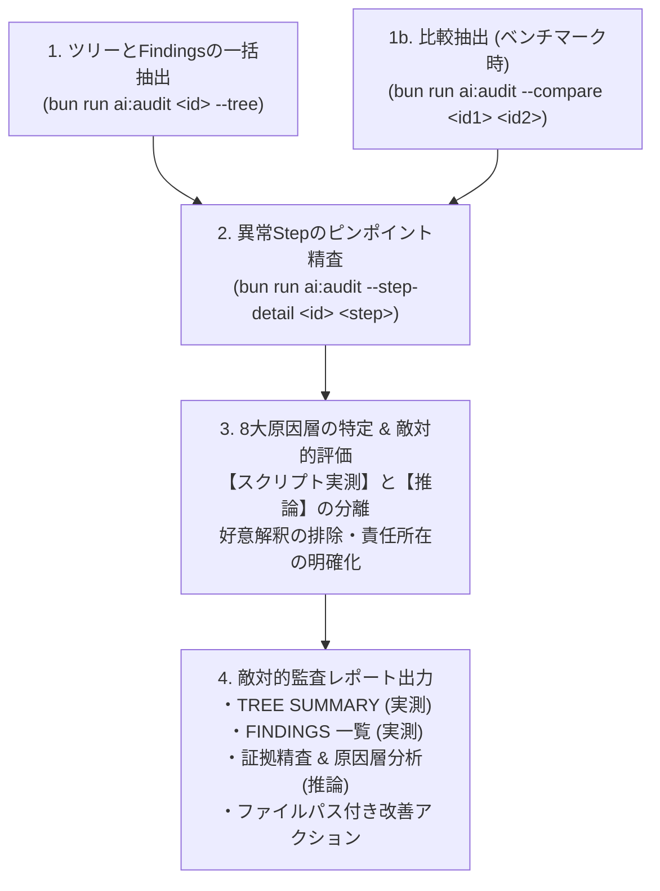

# 敵対的セッション・エージェント行動監査スキル (Adversarial Session Audit Protocol)

本スキルは、別コンテキストや過去セッションで走行したエージェント（Planner / Worker / Reviewer / Scout）の実行ログを、**最小トークンで調査・診断し、エージェントパイプラインのボトルネック・規約違反・ガード誤爆を冷徹・敵対的に糾弾・改善する** ための標準プロトコルです。

---

## 1. 監査の全体フロー (End-to-End Workflow)



---

## 2. 構造化ログ抽出コマンド (Core Audit Commands)

生の `transcript.jsonl` を安易に `cat` や `view_file` で開いてはならない（トークンが急膨張し、物理ガードでも遮断される）。必ず専用スクリプトを使用すること。

### A. セッションツリーと全検出器の自動実行（基本初手）
親セッションおよび全サブエージェントを再帰走査し、サマリーと 23 検出器の Findings を 1 手で出力する。
```bash
bun run ai:audit <session_id> --tree
```
* **出力項目**:
  * TREE SUMMARY: Turns, Duration, Total Tokens, Hook Denials, Redo/Loops, Subagents 数
  * FINDINGS: INFRA, EXP, READ の全 23 検出器による HIGH / MED / LOW / INFO 判定と Step 番号

### B. ステップピンポイント精査 (Zero-Token Evidence Inspector)
疑わしい Step の ToolCall, Arguments, Status, Error/Output を最大 2000 文字でピンポイント抽出する。
```bash
bun run ai:audit --step-detail <session_id> <step>
```

### C. ステップ範囲の概要確認
指定ステップ範囲のツール呼出サマリー（1行要約）を確認する。
```bash
bun run ai:audit --steps <session_id> --range 50:80
```

### D. 2セッションの横並び比較 (Benchmark Comparison)
改善前（Before）と改善後（After）の効果を客観的に比較する。
```bash
bun run ai:audit --compare <before_id> <after_id>
```

---

## 3. 23 検出器体系 (Audit Detectors)

スクリプト（`ai:audit`）は以下の 23 項目を自動判定する：

| カテゴリ | ID | コード | 重大度 | 検知内容 |
| :--- | :--- | :--- | :--- | :--- |
| **INFRA** | INFRA-01 | `TOOL_MISSING` | HIGH | 必要なツール（run_command 等）が未付与で失敗 |
| | INFRA-02 | `HOOK_ROLE_MISMATCH` | HIGH | ガードがエージェントのロールを誤認して誤爆 |
| | INFRA-03 | `UNEXPANDED_TEMPLATE` | MED | `<conversation-id>` 等のテンプレート変数が未展開 |
| **EXP** | EXP-01 | `SCOUT_BYPASS` | HIGH | 関連 3 件以上の探索を自前で実行（Scout 委譲バイパス） |
| | EXP-02 | `BAD_FIRST_MOVE` | HIGH | repo_summary.txt 以外の巨大ファイルを初手読込 |
| | EXP-03 | `EXPLORE_SHARE_EXCESS` | MED | 探索コマンドの割合が全ターンの 30% 超過 |
| | EXP-04 | `SERIAL_INDEPENDENT` | MED | 独立した読込・確認コマンドの直列実行（並列化違反） |
| | EXP-05 | `LINECOUNT_PUZZLE` | HIGH | wc -l や行数確認コマンドの連打 |
| | EXP-06 | `GUESSED_PATH` | HIGH | 存在未確認パスへの当て推量アクセス |
| | EXP-07 | `SCOPE_VIOLATION` | HIGH | 差分スコープ外の全体検査コマンド無断実行 |
| | EXP-08 | `REPEAT_DENIAL` | HIGH | ガード遮断後に同一または類似違反の再実行 |
| | EXP-09 | `ROLE_VIOLATION` | HIGH | レビュー専任中のコマンド実行や実装など |
| | EXP-10 | `BLIND_REDO` | HIGH | 同一コマンドの無意味な再実行（引数・環境不変） |
| **READ** | READ-01 | `SMALL_SLICED` | HIGH | 400 行以下小型ファイルのスライス読込 |
| | READ-02 | `SEQ_SLICING` | HIGH | 同一ファイルへの連続スライス読込（ページング） |
| | READ-03 | `LARGE_FULL_BLIND` | MED | 400 行超巨大ファイルの事前 grep なし全文読込 |
| | READ-04 | `DUPLICATE_READ` | MED | 同一ファイルの短時間での無駄な再読込 |
| | READ-05 | `EDIT_WITHOUT_RAW_READ` | HIGH | 無加工 view_file なしの置換・編集実行 |
| | READ-06 | `RTK_READ_BASIS` | HIGH | 要約表示（rtk read）を判断根拠にした編集 |
| | READ-07 | `RAW_LOG_READ` | HIGH | transcript.jsonl の直接 cat/view_file |
| | READ-08 | `HEAVY_READ_TOP` | MED | 読込上位 3 ファイルのトークン偏重 |
| | READ-09 | `READ_UNUSED` | LOW | 読込後一度も参照・編集されなかったファイル |
| | READ-10 | `WORKER_EXPLORES` | HIGH | Worker による広範囲探索（Scout/Planner 責務逸脱） |

---

## 4. 8大原因層の特定 (The 8 Root Cause Layers)

監査官は、検出された Finding や不効率の根本原因を以下の 8 層から客観的に特定する：

1. **Planner**: タスク分解不備、Scout 委譲バイパス、未決定事項の勝手実装、過大なコンテキスト保持
2. **Worker**: TDD 手順違反、ガード遮断後の反省なし再実行、生コマンド連打、スライス読込
3. **Scout**: 調査範囲の拡散、生コードの過剰引用、トークン削減失敗
4. **Reviewer**: 4大定性監査の形骸化、要件ハックやホスト境界違反の見逃し
5. **Hook (ガード)**: 親エージェントや他ロールに対する誤爆、不親切なエラーメッセージによる迷走誘発
6. **Rule (.agents/rules/)**: 規約の不備、曖昧な指示、非現実的な制約
7. **Agent 定義 (.agents/agents/)**: ツール権限の欠落、不適切なモデル指定、プロンプトの不備
8. **Script (.agents/scripts/)**: スクリプトのバグ、終了コードや出力形式の不整合

---

## 5. 敵対的監査レポートテンプレート (Adversarial Audit Report Template)

調査結果は以下のフォーマットで冷徹・論理的に出力する：

```markdown
# 敵対的セッション監査レポート: <session_id>

## 1. エグゼクティブサマリー (Executive Summary)
- 【スクリプト実測】総ターン数: XX, 所要時間: XX秒, 合計トークン: XX K, Hook Denials: X件
- 【推論】パイプライン全体の総合評価（冷徹判定：合格 / 要改善 / 致命的欠陥）。成功という結果に惑わされず、工程の無駄や規約違反を総括。

## 2. 定量実績 (Quantitative Tree Summary)
【スクリプト実測】（手集計値ではなく `ai:audit --tree` の出力をそのまま転記）
| 項目 (Metric) | 実測値 | 判定・所見 |
| :--- | :--- | :--- |
| **Total Turns** | XX ターン (親: XX, 子: XX) | — |
| **Duration** | XX 秒 (Think: XXs, Tool: XXs) | — |
| **Total Tokens** | In: XX / Cache: XX / Out: XX | — |
| **Hook Denials** | X 件 | — |
| **Redo / Loops** | X 件 | — |
| **Subagents** | X 体 (Scout: X, Worker: Y, Reviewer: Z) | — |

## 3. 自動検出結果 (Automated Findings)
【スクリプト実測】（`ai:audit --tree` の FINDINGS リストを転記）
- [HIGH] `EXP-01` SCOUT_BYPASS: Step 12 (Planner 自前探索)
- [HIGH] `READ-01` SMALL_SLICED: Step 45 (400行以下スライス読込)
- [MED] `EXP-04` SERIAL_INDEPENDENT: Step 23-24 (直列コマンド実行)

## 4. 証拠精査と原因層分析 (Evidence & Root Cause Analysis)
【スクリプト実測】Step XX の詳細: `--step-detail <session_id> <step>` の出力引用
【推論】原因層の特定と行動理由の糾弾:
- **問題事象**: 何が起きたか
- **原因層**: Planner / Worker / Scout / Reviewer / Hook / Rule / Agent定義 / Script
- **なぜ起きたか**: プロンプトの甘さ、ガードのメッセージ不備、エージェントの規約軽視など、好意解釈を排して論理的に指摘。

## 5. 再発防止と改善アクション (Actionable Remediation)
【推論】再発を物理的・構造的に防止するためのファイルパス付き改善提案：
1. `path/to/rule.md`: ○○の禁止を明文化
2. `path/to/guard.ts`: ○○のパターンを物理遮断するガードを追加
3. `path/to/agent.md`: プロンプトの指示を△△に改修
```
