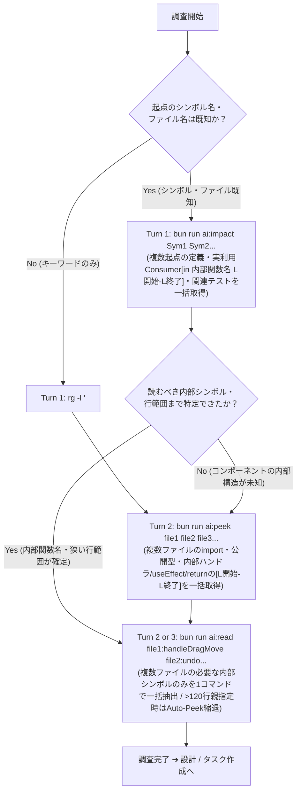

# コード探索パイプラインの敵対的監査と構造改革記録 (Exploration Pipeline Evolution)

本ドキュメントは、セッション `21f2d321-a86b-4dc3-8ca6-356de464b5c7` におけるコンテキスト爆発（Auto-compaction 発生・`ai:read` 未使用）の監査から始まり、敵対的評価（Zero-Trust Review）によって特定された構造的欠陥と、その最終解決アーキテクチャを記録した正本である。

---

## 1. 発端：セッション `21f2d321-a86b-4dc3-8ca6-356de464b5c7` で起きた事象

戦術ボード（`tactical-unified`）の P0 / P1 / P2 複合不具合調査において、`ctrl+o` 監査ログで以下の異常が確認された。

### 実測メトリクス (`bun run ai:audit 21f2d321-a86b-4dc3-8ca6-356de464b5c7 --tree`)
- **総ターン数**: 26 ターン（うち探索フェーズ 23 ターン ＝ **88%**、`EXP-03 EXPLORE_SHARE`）
- **総トークン消費**: `In+Cache = 2,371K`（`In: 313K`, `Cache: 2,059K`） / `Out: 31,035`
- **Auto-compaction 発生 (`READ-11 COMPACT_LOOP_ALERT`)**: Step 108 にて `152K -> 0K` のキャッシュドロップ（記憶喪失）が発生
- **ツール使用内訳**:
  - `bun run ai:read`: **0 回**
  - `bun run ai:impact`: **0 回**
  - `bun run ai:peek`: **19 回**（毎ターン `&&` で2〜4ファイルを別プロセス起動）
  - `read_file`（`>100` 行の大型スライス）: **32 回**（`READ-12 AI_READ_BYPASS`）
  - 連続スライス読込 (`READ-02 SEQ_SLICING`): 1 件（`use-keyboard-shortcuts.ts`）
  - 編集なし重複読込 (`READ-04 DUPLICATE_READ`): 3 件
  - 読込後未使用 (`READ-09 READ_UNUSED`): 20 ファイル以上
  - **Hook Denials**: **0 件**（当時の物理ガードをすべて素通り）

### 当時の探索ステップ（失敗パターン）
1. **Step 1**: `rg -l` を3本並列実行し、多数の候補ファイルをリストアップ。
2. **Step 2**: `bun run ai:peek A && bun run ai:peek B ...` を連発。
3. **Step 3〜23**: `ai:peek` の出力を見た直後、`ai:read` を1度も使わず `read_file(StartLine, EndLine)` で 100〜260行の大型スライスを32回読み込み、Step 108 でコンテキスト上限に到達して Auto-compaction が発生。

---

## 2. 敵対的評価で判明した「5つの真の構造的欠陥」

初期段階では「ルールやスキル（`brainstormer.md` 等）に `ai:read` が明記されていなかったこと」や「`view-filter.ts` がスライス読込をブロックしていなかったこと」を原因と推測した。
しかし、さらに踏み込んだ敵対的評価（実ファイルに対する `ai:peek` / `ai:read` / `ai:impact` の出力検証）を行った結果、**ツール側の構造的欠陥によってエージェントが大型スライスを読まざるを得ない状態に追い込まれていた**ことが判明した。

### 欠陥 1 [CRITICAL]: `ai:peek` の「トップレベル盲目症（Top-Level Blindness）」
- **メカニズム**:
  Footics のコードベース（React Component / Custom Hook / Zustand Store Factory）は「1ファイル＝1巨大トップレベル関数（100〜297行）」構造になっている。
  旧 `.agents/scripts/peek.ts` はトップレベル AST ノードしか出力しなかったため、実際に `21f2d321` で `ai:peek` されたファイルの出力は以下の1行のみだった：
  - `use-marker-drag-handlers.ts` (257行) ➔ `[L36-L256] export function useMarkerDragHandlers(...)`
  - `BillboardObjectLayer.tsx` (297行) ➔ `[L44-L296] export const BillboardObjectLayer = memo(...)`
  - `CanvasStageContainer.tsx` (240行) ➔ `[L38-L239] export function CanvasStageContainer(...)`
  - `document-store.ts` (129行) ➔ `[L32-L128] export function createDocumentStore(...)`
- **なぜ `ai:read` が使えなかったか**:
  `read.ts`（`ai:read`）はネストされた内部関数（`handleMarkerDragMove`）や Store アクション（`undo`）を単体抽出する能力を持っていたにもかかわらず、`ai:peek` が**内部シンボル名も `[L開始-L終了]` も一切表示しなかった**ため、エージェントは内部シンボルを指定できず、`ai:peek` が返した `[L36-L256]`（220行）をそのまま丸読みするしかなかった。

### 欠陥 2 [HIGH]: `ai:impact` / `ai:peek` の単一ターゲット運用によるターン・起動コスト爆発
- `ai:read` は複数ターゲット一括指定に対応していたが、`ai:impact` は1ターゲットしか受け付けず、`efficient-exploration.md` でも単一引数しか案内していなかった。
- 複合調査（P0/P1/P2）では起点が複数あるため、1個しか渡せない `ai:impact` が敬遠され `rg -l` ➔ 個別 `ai:peek` 連結（計19回の `bun` + TSパーサ別起動、ツール時間 216秒）に流れた。

### 欠陥 3 [HIGH]: `:行番号` 指定時に親の250行コンポーネントへ化ける AST 境界バグ（リスク A）
- `read.ts` の `findEnclosingContext`（行番号から最小親 AST ノードを特定する関数）が、分割代入宣言（`const { a, b } = useMemo(...)`）、複数行 `useEffect(() => { ... })`、および JSX `return (...)` を名前付きノードとして認識していなかった。
- その結果、それらの内部行を `ai:read file.tsx:185` や `ai:impact` で参照すると、内側のブロック（20〜40行）を素通りして**外側の親コンポーネント全体（250行）が抽出されてしまうリスク**が存在した。

### 欠陥 4 [HIGH]: `ai:peek` / `ai:impact` / `ai:read` 自身のコンテキスト肥大化リスク（リスク B・C・D）
- **リスク B (`ai:peek`)**: 関数の分割代入パラメータが14行に改行展開され、`interface` も行数無制限で全文出力されていたため、複数ファイル一括実行時に `peek` 出力自体が肥大化する懸念があった。
- **リスク C (`ai:impact`)**: Consumer 一覧に単なる `import { ... }` 行まで含まれており、1枠を浪費していた。
- **リスク D (`ai:read`)**: 上限が `400` 行だったため、`bun run ai:read File.tsx:BillboardObjectLayer` と親コンポーネント名を指定すると 253行丸ごと出力できてしまった。

### 欠陥 5 [HIGH]: 物理ガード（`view-filter.ts` / `token-filter.ts`）のバイパス穴
- 本番コード 616ファイルの行数分布を計測したところ、1ファイル300行上限ルールにより **200〜299行に 118ファイル、100〜199行に 207ファイル（計325ファイル）** が集中していた。
- 旧 `STRUCTURE_GATE_LINE_LIMIT = 150` 行では、`100〜150` 行の中核ファイル（`document-store.ts` 129行等）が未 `peek` で丸読み素通りになっていた。
- また `token-filter.ts` で `cat src/foo.ts` や `rtk read src/foo.ts` がブロックされておらず、`view-filter.ts` をコマンド経由で回避可能だった。

---

## 3. 実装した最終解決アーキテクチャと最適しきい値

### 3.1 コードベース実測に基づくしきい値の最適化

| 制御項目 | 旧設定 | **最終設定** | 根拠・効果 |
| :--- | :---: | :---: | :--- |
| **構造確認ゲート (`STRUCTURE_GATE_LINE_LIMIT`)** | `150` 行 | **`100` 行** | 100行超の本番主要ファイル（325ファイルすべて）で全文 `read_file` を遮断し、`ai:peek` / `ai:read` を強制。100行以下の小規模ファイルのみ直読み可。 |
| **Planner 大型スライス遮断 (`MAX_PLANNER_SLICE_LINES`)** | 制限なし | **`100` 行** | `>100` 行の大型 `read_file` スライス（`21f2d321` で32回発生）を物理遮断し `bun run ai:read` へ誘導。 |
| **`ai:peek` 内部シンボル展開しきい値** | 未展開 | **`25` 行以上** | 25行以上の関数・`memo`・Custom Hook・Store 内部の `useCallback` / `useMemo` / `useEffect` / Storeアクション / `return` の `[L開始-L終了]` を1行ずつツリー出力。 |
| **`ai:peek` 型定義折りたたみ (`MAX_INTERFACE_PEEK_LINES`)** | 無制限 | **`12` 行** | 12行超の `interface` / `type` は先頭8行で折りたたみ、関数引数も1行に正規化して複数ファイル一括 `peek` 時の出力肥大化を防止。 |
| **`ai:read` 単一シンボル上限 (`MAX_SINGLE_SYMBOL_LINES`)** | `400` 行 | **`120` 行** | 120行超の親コンポーネント名が指定された場合、生コード全文ではなく**自動的に内部構造一覧（Auto-Peek Structure）へ縮退**し、内部ハンドラ指定を促す。 |
| **1コマンド最大出力予算** | 400行〜無制限 | **`ai:impact`: 200行 `ai:peek`: 250行 `ai:read`: 250行** | 1ターンあたりのコンテキスト増加量に厳格なハードキャップを設定し、Auto-compaction (`READ-11`) を根絶。 |

### 3.2 監査ディテクターの追加・修正 (`.agents/scripts/lib/audit/detectors/reading.ts`)
- **`READ-12 AI_READ_BYPASS`（新規追加・全34ディテクター体制）**: `>100` 行の TS/JS `read_file` スライス連発や `ai:read` 未使用での多重 TS/JS 読込を自動検出。
- **`READ-03 BLIND_FULL_READ`（修正）**: ディレクトリ単位の `rg` / `ai:peek` 事前実行を正しく構造プローブとして認識するよう修正。

---

## 4. 最終形の探索フロー（最大 2〜3 ターン完結）

### 定量効果まとめ（`21f2d321` 相当の複合調査における比較）
- **探索ターン数**: `23 ターン` ➔ **`3〜5 ターン`**（約80%削減）
- **TS/JS コード読込行数**: `約 4,800 行`（32大型スライス） ➔ **`約 350〜500 行`**（必要な内部ハンドラのみ、約90%削減）
- **Auto-compaction (`152K -> 0K`)**: **発生ゼロ**
