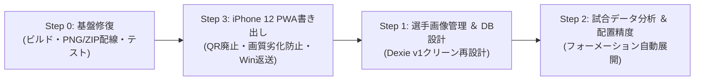

# 戦術ボード・動画書き出しロードマップ (Tactical Board & Export Roadmap)

> **目的**: 最速で「X（Twitter）に高品質な戦術アニメーション動画・静止画をポストできる状態」を確立する。  
> **方針**: 選手画像は一旦妥協して後回し。後方互換性は考慮せず、不要なコードは削除してクリーンに保つ。

---

## 1. 全体進行順序 (0 ➔ 3 ➔ 1 ➔ 2)

| 順序 | テーマ | 主な目的・成果物 |
|---|---|---|
| **Step 0** | **基盤修復 ＆ PC単体動作確立** | 本番ビルドエラー解消、PNG/ZIP保存の正常配線、既存テスト全件PASS |
| **Step 3** | **iPhone 12 PWA 動画書き出し ＆ Windows返送** | QR廃止、PWA化、画質劣化防止（写真アプリ回避）、Windowsへの無劣化転送 |
| **Step 1** | **選手画像管理 ＆ DB設計** | 選手顔写真の最適保存（256×256 WebP・`player_photos` 分離）、Dexie `version(1)` クリーン再設計 |
| **Step 2** | **試合データ分析 ＆ フォーメーション自動配置** | 試合JSONからのスタメン抽出精度向上、ピッチ論理座標（0-100）自動展開 |

---

## 2. 各ステップの詳細要件

### Step 0: 基盤修復 ＆ PC上での単体動作確立
* **ビルドエラー解消**:
  * `src/app/export/share/[shareId]/page.tsx` に残存する旧 `video-export-worker.ts` 参照を削除。
* **静止画（PNG / ZIP）保存の正常配線**:
  * モーダルからのエクスポートで、裏側 Canvas レンダラー（`renderTacticalFrameToCanvas`）を接続し、Blob生成・自動ダウンロードを発火させる。
  * ※ **ZIPの役割**: プロジェクト内の全スライド（シーン1〜N）を高解像度連番PNG（`slide-01.png`, `slide-02.png`...）として1つのZIPファイルにまとめて一括保存するための機能。
* **テスト3ファイルの修正**:
  * `src/lib/tactical/__tests__/video-export-engine.test.ts` (Canvasモックに `translate`/`scale` 追加)
  * `src/features/tactical-unified/views/__tests__/full-tactical-canvas-integration.test.tsx` (キャンバス幅・GSAP統一に追従)
  * `src/features/tactical-unified/__tests__/benchmark-presets.test.ts` (合計時間計算値の追従)
* **完了判定**: `bun run build` 成功 ＆ Vitest 全件合格。

---

### Step 3: iPhone 12 専用 PWA エクスポート ＆ Windows への無劣化返送
* **背景**: アニメーション作成PCのスペックが低いため、iPhone 12（A14 Bionic）の高効率エンコーダを活用して高速動画レンダリングを行う。
* **QRコード方式の完全廃止**:
  * カメラ起動やスキャンの手間をなくすため、QRコード関連コード・UIを完全撤去。
* **PWA（ホーム画面追加）の採用**:
  * iPhone Safari で Footics を開いて「ホーム画面に追加」するだけで、全画面アプリとして起動可能にする。
* **iPhone専用DL画面の設計**:
  * 編集UI（ツールバー、右パネル、タイムライン操作など）は一切置かない。
  * 「プロジェクト一覧/選択 ➔ ループプレビュー確認 ➔ 書き出し開始」のみの超軽量・閲覧/書き出し特化UI。
* **Windows Edge との描画同一性（ピクセル一致）**:
  * iOS WebKit 固有のフォント描画差や解像度スケール差を吸収し、Windows Edge の作業画面と寸分違わぬ同一レンダリング結果（ピッチ・選手円・矢印・テキスト）を保証。
* **画質劣化防止（写真アプリ回避）**:
  * iOS の「写真（Photos）」アプリへ保存すると、OSによる自動トランスコードや再圧縮で動画の品質が低下するリスクがある。
  * 写真アプリを避け、「ファイル（Files）」アプリへの非圧縮保存、または直接ブラウザからWindows側へ転送するルートを採用する。
* **Windows側への無劣化返送方式の検討**:
  1. **ローカルネットワーク直接アップロード（推奨）**:
     * iPhone側でレンダリング完了後、「PCへ転送」ボタンを押すと、同一Wi-Fi上の Footics 開発サーバー（PC）のAPIへMP4ファイルを直接POSTし、Windows側の保存フォルダへ即座に格納する。
  2. **PC側からの直接受信（ローカルWeb共有）**:
     * iPhoneのPWAが一時的なダウンロードリンクを生成し、PC側のブラウザから取得する。
  3. **クラウドストレージ経由（Cloudflare R2 等）**:
     * 高速な一時バケットを介して相互同期する。

---

### Step 1: 選手画像管理 ＆ DB設計（選手画像の本格導入時）
* **選手顔写真の保存・管理**:
  * アップロード時に 256×256px 正方形センタートリミング ＋ WebP（品質 0.85）へ自動変換し、IndexedDB の専用テーブル `player_photos`（`playerId` 主キー）へシーズン横断で1選手1レコード格納。
* **Dexie DB スキーマのクリーン刷新（`version(1)` 一本化）**:
  * 後方互換性や過去マイグレーション（`v15`〜`v20`）をすべて撤廃し、死にテーブル（`tactical_snapshots`, `event_memos`）の削除とインデックス最適化を行った上で `this.version(1)` に再設計（旧 v20 DB との `VersionError` は自動削除リカバリで解決）。
* **戦術ボード・エクスポート反映**:
  * **2Dサークル（`circle`）**: マーカー内の表示モード（`Photo`）と `player_photos` データの接続（Konva 編集画面・PC静止画/動画エクスポート・iPhone PWA エクスポートすべてで円内クリップ描画、写真未登録時は背番号にフォールバック）。
  * **3D足元リング（`ring`）**: リング中央には何も表示しない仕様に統一（中央の背番号描画を廃止し、下部ラベルのみ表示）。

---

### Step 2: 試合データ分析 ＆ フォーメーション自動配置の精度向上
* **試合データ抽出ロジックの刷新**:
  * WhoScored / Opta 等の外部データからスタメン11人、控え選手、フォーメーション情報を高精度に抽出。
* **ピッチ自動配置エンジンの再設計**:
  * ポジション（GK, CB, LB, RB, DM, CM, LW, RW, CF等）からピッチ論理座標（`0〜100`）へ綺麗に落とし込む展開アルゴリズム。
* **陣地反転（Home/Away、Swap）時の配置整合性確保**。
